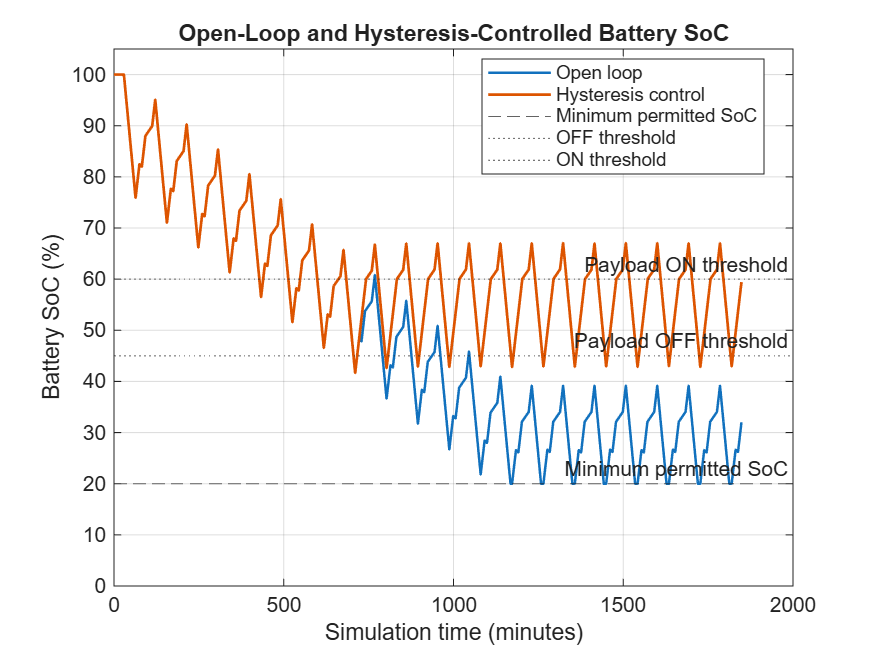
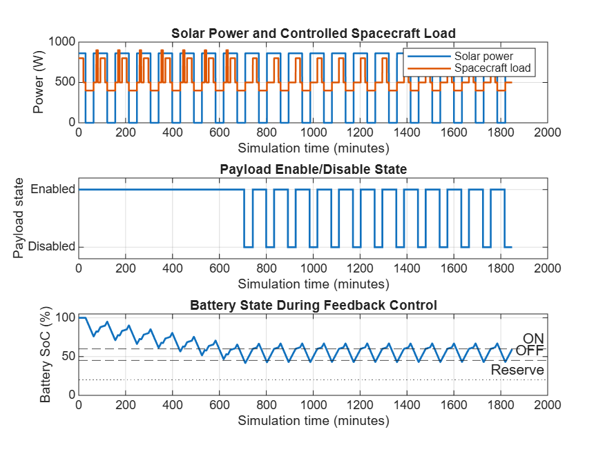
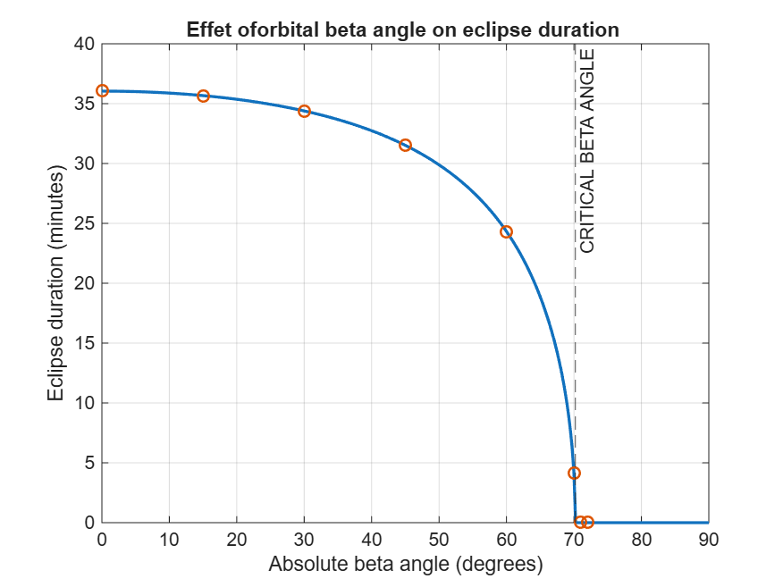
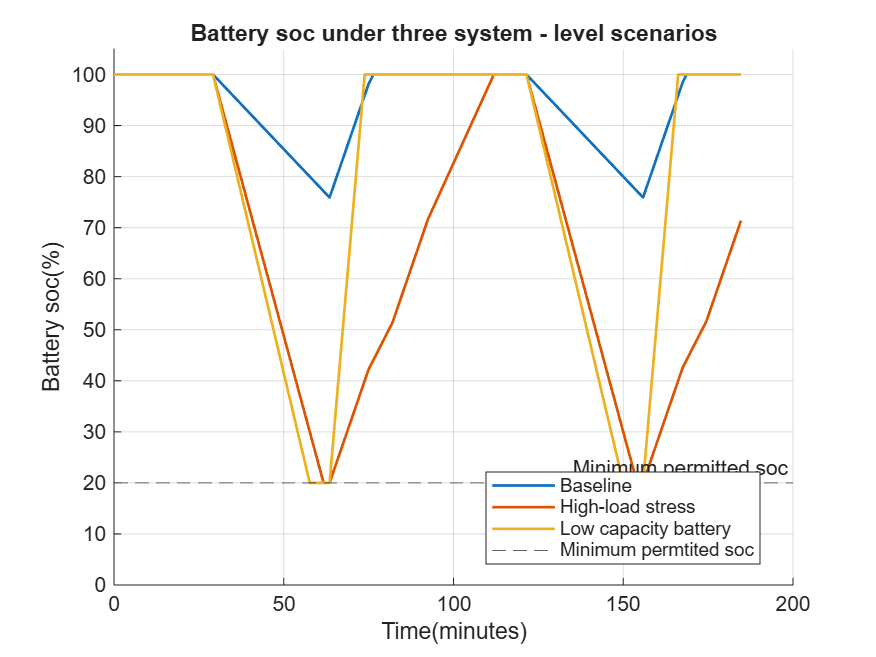

#MATLAB-Based LEO-Spacecraft-ElectricalPowerSystem-Simulation

A MATLAB simulation of the electrical power system (EPS) of a spacecraft in circular Low Earth Orbit, from orbit geometry and solar-array power to battery behaviour and a SoC-based hysteresis load-shedding protection

## What it models
- Sunlight and eclipse timeline, and eclipse duration vs Sun beta angle
- Solar-array power generation, Beginning-of-Life vs End-of-Life degradation
- Battery SoC, charge/discharge behaviour and losses
- Solar-array and battery sizing sensitivity
- Dynamic mission loads (safe, nominal, science, comms modes)
- Integrated simulator with energy-accounting checks
- SoC hysteresis (ON/OFF) load-shedding controller

## Key results
| Study | Result |
|---|---|
| EOL sizing sweep |Analytical EOL sizing estimates: approximately 3.97m2 solar array and 632Wh battery capacity under simplified asssumption  |
| Integrated baseline | Min SoC 75.9%, 0 Wh unserved, energy accounting passed |
| High-load stress case | Min SoC 20%, 82.2 Wh unserved |
| Low-capacity battery case | Min SoC 20%, 77.8 Wh unserved |
| Hysteresis control (20 orbits, 2.5 m2 array, OFF 45% / ON 60%) | Open loop: min SoC 20%, 360.5 Wh unserved. Controlled: min SoC 41.6%, 0 Wh unserved, payload shed 106 min, 25 switching events |

## Selected plots

## Scripts (src/)
| Script | Purpose |
|---|---|
| orbital_basics.m | Orbit basics |
| orbital_timeline.m | Sunlight/eclipse timeline |
| solar_array_model.m | Solar-array power model |
| battery_model.m | Battery SoC model |
| degradation_comparison.m | BOL vs EOL comparison |
| eps_sizing_analysis.m | Array/battery sizing sensitivity |
| dynamic_load_simulation.m | Operational modes and dynamic load |
| beta_angle_eclipse_analysis.m | Beta-angle eclipse analysis |
| integrated_eps_simulator.m | Integrated EPS simulator, 3 scenarios |
| soc_hysteresis_control.m | SoC hysteresis load-shedding controller |

## How to run
Open MATLAB, set the repository folder as the current folder, and run the scripts in `src/` in order. Each script writes its plots to `results/`.

## Limitations
This is a preliminary engineering simulation with simplified assumptions. It is not a flight-qualified power-system design.

## Author
Jajala Sri Sai Mukund
